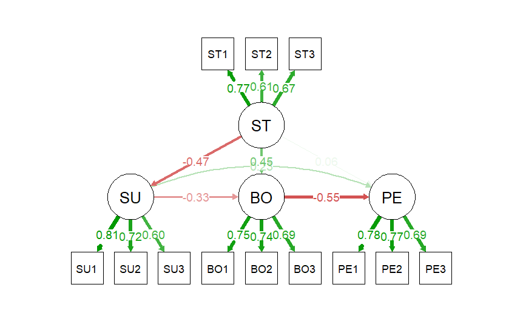

# النمذجة بالمعادلات البنائية (SEM) في R

مشروع تعريفي يوضح خطوات النمذجة بالمعادلات البنائية باستخدام لغة R وحزمة `lavaan`.

> **تنبيه:** البيانات في هذا المشروع **محاكاة** (`set.seed(123)`, n = 300) لأغراض تعليمية فقط، والنتائج لا تمثل علاقة فعلية بين المتغيرات.

## نموذج البحث

الضغط الوظيفي ← الدعم ← الاحتراق الوظيفي ← الأداء (نموذج وساطة متعدد، مع مسارات مباشرة).



## محتوى المشروع

1. توليد بيانات محاكاة (12 عبارة بمقياس ليكرت 1-5، ثلاث لكل متغير)
2. نموذج القياس (CFA)
3. الثبات والصدق (Cronbach's α، CR، AVE، Fornell-Larcker)
4. النموذج البنائي بمقدّر MLR
5. اختبار الوساطة بـ Bootstrap (1000 إعادة سحب)
6. رسم النموذج بحزمة `semPlot`

## أبرز النتائج (بيانات محاكاة)

| المسار | β |
|---|---|
| الضغط ← الدعم | -0.47 |
| الضغط ← الاحتراق | 0.45 |
| الدعم ← الاحتراق | -0.33 |
| الاحتراق ← الأداء | -0.55 |
| الدعم ← الأداء | 0.23 |
| الضغط ← الأداء (مباشر) | 0.06 (غير دال) |

- مطابقة النموذج: χ²(48) = 42.82, p = .684, CFI = 1.00, RMSEA = .000, SRMR = .029
- الأثر غير المباشر الكلي: -0.489، و95% CI [-0.711, -0.340]
- الأثر المباشر غير دال، فالوساطة كاملة

## طريقة التشغيل

```r
install.packages(c("lavaan", "semPlot", "psych"))
source("SEM_project.R")
```

## استخدام بيانات حقيقية

استبدل قسم توليد البيانات بالاستيراد، بشرط أن تكون أسماء الأعمدة `ST1..ST3, SU1..SU3, BO1..BO3, PE1..PE3`:

```r
data <- read.csv("my_data.csv")
```

## الأدوات

R · RStudio · lavaan · semPlot · psych
